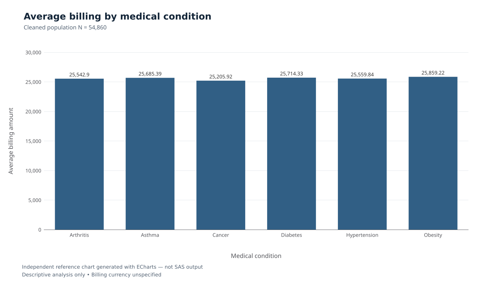
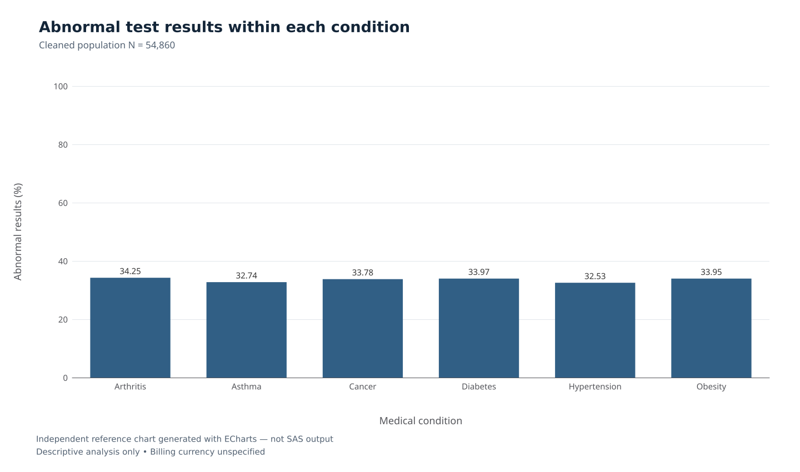
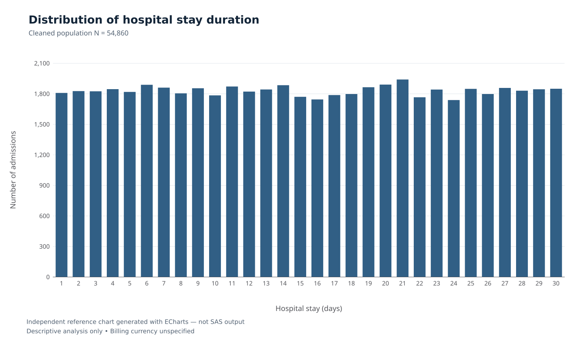

# Healthcare Data Analysis Using Base SAS 9.4

A **Base SAS 9.4 statistical programming portfolio project** demonstrating CSV ingestion, data validation, reproducible cleaning, descriptive statistics, grouped analysis and reporting. The project is designed to demonstrate foundational skills relevant to an Associate Statistical Programmer role.

**Execution status:** the SAS programs have **not been executed** in this environment. The committed tables are independently generated Python reference outputs, verified using DuckDB SQL. The PNGs are independently generated reference charts, **not SAS output or screenshots**. See [validation status](docs/validation_status.md).

## Overview and problem statement

How can admission-level healthcare data be converted into an auditable descriptive report without hiding exclusions, confusing denominators or overstating clinical conclusions?

This project preserves the source CSV, identifies exact field-value duplicates, evaluates data quality before exclusions, defines a nonnegative-billing analysis population, and produces traceable aggregate summaries. It analyzes records/admissions, not unique patients: the file has no reliable patient or visit identifier.

## Dataset and privacy

The supplied local CSV contains **55,500 records and 15 variables**, including age, gender, medical condition, admission/discharge dates, billing, admission type and test results. It contains six condition categories.

It also contains names, doctor/hospital labels and room numbers. The raw file is **not distributed** because provenance, synthetic status and redistribution permission have not been conclusively established for this specific local copy. Its schema matches the commonly used [Healthcare Dataset by Prasad Patil on Kaggle](https://www.kaggle.com/datasets/prasad22/healthcare-dataset); that is a source candidate, not verified chain of custody. See [data access and dictionary](data/README.md).

Only aggregate reference outputs are committed. Code and documentation use the [MIT license](LICENSE); that license does not grant rights to any third-party dataset. This is an educational descriptive project, not clinical evidence or a submission-ready SDTM/ADaM study.

## Technologies and methods

| SAS component | Purpose |
|---|---|
| PROC IMPORT, CONTENTS, PRINT | Import, inspect variable metadata and preview selected non-identifying fields |
| DATA Step | Preserve character source values, parse dates/numbers, flag issues and derive age groups/stay duration |
| PROC SORT | Exact duplicates across all 15 original columns with NODUPKEY, DUPOUT and EQUALS |
| PROC MEANS | N, mean, median, sample standard deviation, minimum and maximum |
| PROC FREQ | Category review and condition/admission/test/age-group frequencies |
| PROC SQL | Counts, overlap reconciliation, grouped summaries and explicit percentage denominators |
| PROC SGPLOT and ODS Graphics | Five reproducible PNG charts and an HTML report when run in SAS |

Python standard-library calculations, Decimal billing arithmetic and independent DuckDB queries provide reference validation. They do not validate the SAS runtime.

## Research questions

1. Which medical condition has the highest average billing?
2. Which has the highest within-condition abnormal-test percentage?
3. How does hospital stay duration differ by condition?
4. What proportion of admissions are emergency or urgent?
5. How does billing vary by admission type?
6. How does hospital stay duration differ by age group?

## Reproducible cleaning workflow

1. Inspect all 15 fields and all records; do not edit the source CSV.
2. Count exact duplicate copies using all original decoded field values, before conversions or derived variables.
3. Report missingness, invalid age, missing/invalid billing, negative billing, invalid dates, negative stays and categorical levels on both raw and deduplicated populations.
4. Remove exact duplicate copies, retaining one copy per original-field combination. Retain nonidentical repeated visits.
5. Exclude unique records with invalid required analytical fields or negative billing. Negative bills may be legitimate credits/refunds; they are outside this **nonnegative-charge analysis**, not automatically classified as errors.
6. Reconcile the overlapping exclusions and derive stay = discharge date − admission date. Same-day stays are permitted; stays over 365 days are flagged for review, not silently removed.

The measured reconciliation is **55,500 − 534 − (108 − 2) = 54,860**. Two negative-billing copies are already included in the duplicate count. See [methodology](docs/methodology.md).

## Independently verified reference findings

The following numbers were calculated from the complete local CSV, not hardcoded into analytical programs. Python and DuckDB agreed across **595 numerical or label comparisons** within documented tolerances.

| Metric | Verified reference result |
|---|---:|
| Original observations / variables | 55,500 / 15 |
| Exact duplicate copies | 534 |
| Negative-billing entries before deduplication | 108 |
| Duplicate and negative-billing overlap | 2 |
| Unique negative-billing entries excluded | 106 |
| Cleaned observations | 54,860 |
| Missing cells / invalid dates / negative stays | 0 / 0 / 0 |
| Average age | 51.53 years |
| Average / median hospital stay | 15.50 / 15 days |
| Minimum / maximum hospital stay | 1 / 30 days |
| Average billing | 25,594.63, currency unspecified |
| Highest average billing | Obesity: 25,859.22 |
| Highest within-condition abnormal percentage | Arthritis: 34.25% (3,153 / 9,207) |
| Emergency or urgent admissions | 36,423 / 54,860 = 66.39% |

Group differences are descriptive. No hypothesis testing, clinical significance, causation or treatment effectiveness is established. See [statistical findings](docs/statistical_findings.md) for all six questions, procedures, denominators, interpretations and limitations.

## Reference visualizations

These were produced from verified aggregate CSVs using ECharts and Sharp. Each image is labeled as independent reference output.





Additional charts: [average stay by condition](visuals/average_stay_by_condition.png) and [age distribution](visuals/patient_age_distribution.png). SAS code to generate the five corresponding figures is in [06_visualizations.sas](sas/06_visualizations.sas).

## Repository structure

```text
healthcare-data-analysis-sas/
├── README.md
├── LICENSE
├── .gitignore
├── data/
│   └── README.md                     # CSV omitted; authorized user supplies it
├── sas/
│   ├── run_all.sas
│   ├── 01_import_and_inspection.sas
│   ├── 02_data_validation.sas
│   ├── 03_data_cleaning.sas
│   ├── 04_descriptive_statistics.sas
│   ├── 05_condition_analysis.sas
│   └── 06_visualizations.sas
├── results/                          # Labeled independent reference CSVs and manifests
├── visuals/                          # Five labeled independent reference PNGs
├── docs/
│   ├── methodology.md
│   ├── statistical_findings.md
│   ├── sas_procedures.md
│   ├── interview_explanation.md
│   └── validation_status.md
├── validation/                       # Independent calculation, SQL and chart code
├── tests/                            # Edge-case and repository consistency checks
└── scripts/                          # Conservative publishing helper
```

## Run in SAS Studio with SAS 9.4

1. Obtain authorized access to the source file and confirm provenance. Upload the repository folder into SAS Studio's server files area.
2. Place the unchanged CSV at `data/healthcare_dataset.csv`. Do not publish it merely because the code license is MIT.
3. In a new SAS program set the uploaded folder's absolute server path, then include the driver:

   ```sas
   %let project_root=/your/uploaded/healthcare-data-analysis-sas;
   %include "&project_root/sas/run_all.sas";
   ```

   The example path is a placeholder. Alternatively configure `SAS_PROJECT_ROOT` in the SAS server environment. No local machine path is embedded in the programs.
4. The driver executes modules 01–06 in order. It writes actual SAS CSVs, an HTML report, a log and a completion receipt under `results/sas/`, and actual SAS PNGs under `visuals/sas/`. These ignored directories keep SAS outputs separate from the committed reference results. Row-level tables remain in WORK.
5. Inspect the full SAS log for errors, invalid data notes, truncation, conversion problems and unexpected missing values. A completion receipt alone is insufficient. Compare SAS CSVs with the references:

   ```bash
   python validation/compare_sas_outputs.py --sas-results results/sas
   ```

6. Preserve a successful SAS log privately before claiming execution. The SAS distribution must provide ODS Graphics/PROC SGPLOT. Actual compatibility and execution remain pending.

## Reproduce independent reference outputs

Python 3.11+ is sufficient for the reference calculations and unit checks. The SQL verifier additionally requires the pinned DuckDB dependency.

```bash
python validation/reference_analysis.py --input /authorized/path/healthcare_dataset.csv
python -m pip install -r validation/requirements.txt
python validation/sql_crosscheck.py --input /authorized/path/healthcare_dataset.csv
python -m unittest discover -s tests -v
python validation/check_repository.py
```

Optional reference chart reproduction requires Node.js 20+ and the listed packages:

```bash
npm install --prefix validation
node validation/render_reference_charts.mjs
```

The original input SHA-256 is recorded in [validation_manifest.json](results/validation_manifest.json). SAS comparisons and independent SQL checks reject inconsistent results. See [results provenance](results/README.md) and [chart provenance](visuals/README.md).

## Scope and limitations

- No reliable unique patient or encounter identifier; counts are records, not unique people. Even identical real visits could be legitimate, so duplicate removal is a documented file-level policy.
- Data provenance and redistribution rights for the local CSV are unresolved; patient-level data is omitted.
- Currency, healthcare setting, severity, diagnostic criteria, clinical timing and test definitions are not provided.
- Calendar-date differences measure elapsed days; no inclusive +1 adjustment or timestamp precision is implied.
- No inferential tests, causal effects, clinical efficacy, safety or treatment-effect claims.
- The supplied legacy script `Healthcare_Analysis_Base_SAS_9_4.sas` was not accessible during preparation. Its review and migration comparison remain pending; this modular implementation does not claim to have preserved unseen logic.
- SAS execution and authenticated GitHub publication have not yet been verified.

## Skills demonstrated

Base SAS programming; DATA Step derivations; numerical/date validation; duplicate and exclusion accounting; descriptive statistics; correct denominators; grouped SQL; ODS reporting; reproducible analysis; independent validation; restrained healthcare interpretation; clear technical documentation.

An interview-ready explanation is provided in [interview_explanation.md](docs/interview_explanation.md).
